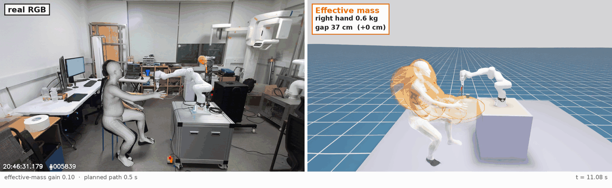
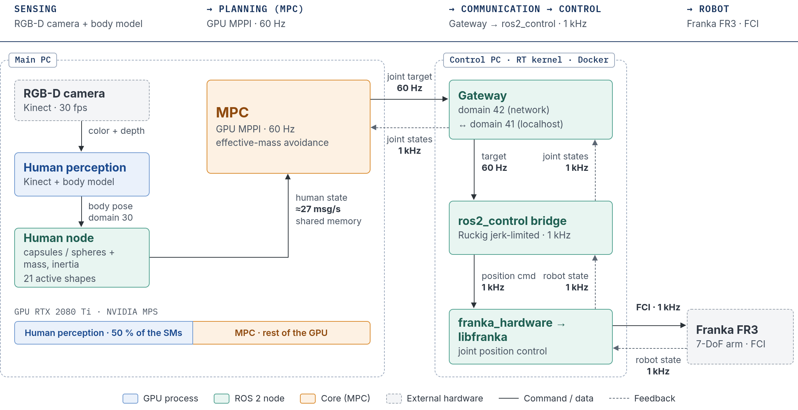

> **English summary.** Real-robot side of [effmass-mpc](https://github.com/ukhyeon/effmass-mpc): a real-time human-avoidance MPC (GPU MPPI, NVIDIA GPU MPC library) on a Franka FR3 whose clearance zone around each body part is set from the human's directional effective mass. The MPC runs on a main PC at 60 Hz and sends joint targets over a wired LAN to a control PC (ROS 2 gateway, ros2_control bridge with Ruckig, 1 kHz, FCI). A comparison with uniform avoidance is in preparation.

# effmass-mpc-franka

## 1. 소개

사람의 방향별 유효질량으로 이격 구역을 정하는 실시간 사람 회피 MPC 를 Franka FR3 실물에서 돌린다. 시뮬 저장소: [effmass-mpc](https://github.com/ukhyeon/effmass-mpc).

로봇이 사람 몸의 어느 부위에 어느 방향으로 다가가는지에 따라, 그 방향으로 사람 몸이 받아내는 유효질량을 매 제어 주기마다 계산해 이격 구역의 두께를 정한다. 이 저장소는 그 실물 구성의 메인 PC 코드(사람 입력 연결, MPC 실행기, 유효질량 비용 커널, 실행·분석·시각화 스크립트)이고, 방법과 시뮬 비교는 effmass-mpc 에 있다.

## 2. 데모



*유효질량 회피로 실물 FR3 를 돌린 실행 하나(30 s 중 약 5 s).*

화면 읽는 법:
- **왼쪽**: 실제 RGB 카메라 영상 위에, 사람 인식이 추정한 SMPL 몸(회색)을 겹쳐 그렸다.
- **오른쪽**: 같은 순간의 3D 재구성이다. 로봇 관절은 기록된 측정값이고, 사람은 MPC 가 받은 사람 데이터다.
  - **주황 볼륨**: 팔 부위마다의 방향별 이격 구역이다. 유효질량이 큰 방향일수록 두껍다.
  - **빨간 선**: 그 순간 MPC 가 계획한 앞으로 0.5 s 의 손끝(TCP) 경로다.
  - **글자 상자**: 로봇에 가장 가까운 사람 부위, 그 방향의 유효질량, 거리다.

## 3. 시스템 구성



- **메인 PC**: 사람 인식과 MPC 가 GPU 하나를 나눠 쓴다(NVIDIA MPS, 사람 인식 쪽 SM 50 %). MPC 는 시뮬레이터 화면 없이 NVIDIA GPU MPC 라이브러리로 돈다. 사람 데이터와 관절 상태는 각각 별도 프로세스가 받아 공유 메모리에 최신 1개만 둔다.
- **사람 인식**: 비공개 저장소 hrc_ws 다. 이 저장소에는 넣지 않았다. RGB-D 영상에서 SMPL 몸을 추정하고, 사람 노드가 분절 19개의 질량중심·속도·역관성과 부위별 형상 24개(구·캡슐)를 ROS 2 메시지로 낸다. MPC 가 받는 형식(입력 인터페이스)은 [docs/human_interface.md](docs/human_interface.md) 에 있다. 이 형식으로 넣으면 다른 인식으로 바꿀 수 있고, 합성 사람으로 카메라 없이 돌릴 수도 있다.
- **제어 PC**: 게이트웨이가 유선 LAN 쪽 ROS 네트워크와 브리지 쪽 localhost 네트워크를 잇는다. 브리지(ros2_control 컨트롤러)는 60 Hz 목표를 Ruckig 로 1 kHz 명령으로 잇고, 목표가 0.1 s 끊기면 가속도·저크 한계 안에서 감속해 선다.

**실시간 기록** (데모 실행 1개, 30 s, 1800 스텝; 실행 요약 json 의 값):
- MPC 발행 60.0 Hz.
- 스텝 계산 시간: 중앙값 11.1 ms, 99 % 16.8 ms. 계산이 1/60 s 를 넘은 스텝은 20개(1.1 %)다.
- 정해진 시각보다 늦게 발행한 스텝은 67개(3.7 %, 최대 22.8 ms)이고, 건너뛴 스텝은 0개다.
- 받은 사람 데이터: 30 s 동안 605개(약 20 Hz).

## 4. 식과 핵심 설정

사람의 부위(형상) 하나와 가장 가까운 로봇 구 사이에서, 로봇 구에서 그 부위를 향하는 단위 방향 u 를 잡는다. 그 방향의 사람 유효질량과 이격 구역 두께는 다음과 같다.

```
m_h = 1 / (u^T Λ_h^{-1} u)                          Λ_h^{-1}: 그 부위가 속한 분절의 작업공간 역관성 (사람 데이터)
eta = clamp( d0 + k * max( sqrt(m_h / m_iso) - 1, 0 ),  d0,  eta_max )
```

- m_iso 는 부위별 ISO/TS 15066 기준 질량이다. 유효질량이 기준보다 큰 방향만 두꺼워진다.
- 비용은 이격 구역(eta 안으로 들어가지 않게)과 그 바깥의 위험 필드(경계 전부터 미리 돌아가게)로 이뤄진다.

| 설정 (2026-11-24 실행) | 값 | 옵션 |
|---|---|---|
| 질량 모드 | 사람 유효질량 m_h (위 식) | `--human-mass-mode human` (`MASS_MODE=human`) |
| 팔 부위 d0, k, eta_max | 0.10 m, 0.10, 0.40 m | `--human-d-base 0.10`, `real_run.sh` 기본 k 0.10, eta_max 0.40 |
| 어깨 | 팔 부위에 포함, 기준 질량 3 kg | `--human-shoulder 1` |
| 팔 밖 부위 | d0 0.03 m (질량 항 없음) | `real_run.sh` 기본 `--human-other-d-base 0.03`, `--human-other-k-gain 0` |
| 로봇 link0·link1 | 사람 비용에서 제외 (구 6개) | `--human-robot-exclude link0,link1` |
| 로봇 받침 위 사람 후보 | 사람으로 쓰지 않음 | `--human-base-exclude goal1/config/base_exclude.yaml` |
| 가슴 방향 | SMPL spine3 회전 반영 (사람 노드 쪽) | `HUMAN_CHEST_SPINE3=1` |
| 위험 필드 | W 100 | `--human-field 1 --hf-wt 100` |
| 속도 | 0.5 m/s | `real_run.sh` 기본 `--lim-ref cmd --lim-v 0.50` |
| MPC 계획 경로 기록 | 0.5 s 앞 | `--rec-plan 1` |

전체 실행 설정 예시: [main_pc/goal1/config/h1_choice.env.example](main_pc/goal1/config/h1_choice.env.example)

## 5. 실행 방법

필요한 것: [effmass-mpc](https://github.com/ukhyeon/effmass-mpc) 와 그 실행 환경, ROS 2 Humble, 사람 데이터(hrc_ws 또는 [인터페이스](docs/human_interface.md)대로 만든 입력), 제어 PC(실시간 커널, Docker, franka_ros2, libfranka, Ruckig).

| 의존성 | 비고 |
|---|---|
| effmass-mpc | 공통 코드(`step2_scene.py`, `step3_ros_common.py`, `g1_human_link.py`). 이 저장소의 `main_pc/` 를 그 위에 같은 경로로 복사한다 |
| Isaac Sim 4.5 의 python, cuRobo (NVIDIA GPU MPC 라이브러리), NVIDIA Warp | 별도 설치. 시뮬레이터 화면은 쓰지 않는다 |
| FR3 로봇 설정 (franka_description 의 FR3 v2.1 URDF, 충돌 구) | 타사 자산에서 나온 것이라 넣지 않았다. `goal1/fr3v2_1/` 에 만든다 |
| ISO/TS 15066 부위별 값 | `goal1/data/iso_15066.json` (effmass-mpc 와 같이 넣지 않았다) |
| hrc_ws (사람 인식, 사람 노드) | 비공개 저장소 |

순서:
1. effmass-mpc 를 받고 `main_pc/` 를 그 위에 복사한다: `rsync -a main_pc/ ~/effmass_mpc/` (다른 위치면 `EFFMASS_ROOT` 를 준다).
2. `ws/` 에서 `effmass_msgs`, `effmass_robot` 을 `colcon build` 한다.
3. `goal1/config/` 의 예시 세 개를 복사해 채운다: `hosts.env`(제어 PC 주소, 사람 인식 시작 명령), `fastdds_main_pc.xml`(두 PC 주소), `h1_choice.env`(실행 설정).
4. 사람 쪽 켜기: `goal1/real_prep5/rp5_human_up.sh start` (MPS, 사람 인식, 사람 노드, 사람 데이터 15 Hz 이상 확인).
5. 실행: `goal1/scripts/real_run.sh c1k <MPC 초> --human`. 제어 PC 의 홈 자세와 브리지를 켜고, 사람 데이터와 GPU 를 확인한 뒤 MPC 를 돌리고, 정지 순서까지 마친다. 결과는 `goal1/real_prep4/<이름>_*` 에 남는다.
6. 끄기: `goal1/real_prep5/rp5_human_up.sh stop`.
7. 분석과 그림: `goal1/real_prep5/exp1121/exp_ana.py` (거리, 회피 시작 거리), `goal1/real_prep5/exp1121/viz2/v5/run_v5.sh <실행 이름>` (위 데모 형식의 PNG / MP4 / GIF; Isaac 재렌더, SMPL 겹치기는 hrc_ws 의 SMPL 패키지와 몸 모델이 필요).

카메라 없이 시험: 합성 사람(`rp5_synth_human.py`)이나 기록 재생(`real_run.sh --human-replay <이름>_human.npz`)을 쓴다. 자세한 설치, 실행, 안전과 정지 순서: [docs/setup_and_run.md](docs/setup_and_run.md)

## 6. 진행 중

균일 회피와의 비교 영상은 준비 중이다.

## 참고문헌

1. ISO/TS 15066:2016, Robots and robotic devices - Collaborative robots.
2. G. Williams et al., "Information theoretic MPC for model-based reinforcement learning," ICRA, 2017.
3. B. Sundaralingam et al., "cuRobo: Parallelized collision-free minimum-jerk robot motion generation," arXiv:2310.17274, 2023.
4. L. Berscheid and T. Kröger, "Jerk-limited real-time trajectory generation with arbitrary target states," RSS, 2021. (Ruckig)
